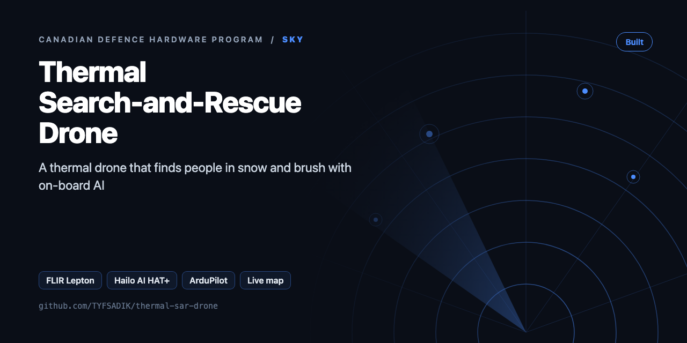
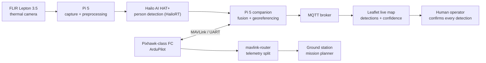

<div align="center">



# Thermal Search-and-Rescue Drone

**X500-class quadcopter with FLIR Lepton thermal camera and Hailo AI HAT+ edge detection that finds people in snow and brush, pushing detections to a live map.**

[](https://github.com/TYFSADIK/thermal-sar-drone/actions/workflows/tests.yml)   [](LICENSE) [](https://github.com/TYFSADIK/defence-hardware-program)

[Build guide](docs/project-page.md) · [How it works](#how-it-works) · [Quick start](#quick-start) · [Program hub](https://github.com/TYFSADIK/defence-hardware-program)

</div>

## Overview

The Army's MINERVA challenges say it plainly: Canada currently lacks a drone that can do ISR in Arctic conditions. The Arctic requirement calls specifically for **sovereignty operations and search and rescue with the Canadian Rangers**. Detecting a person in snow or brush from a cheap thermal camera is the sharpest hobby-scale version of that requirement, and it is what this build does.

The airframe is an **X500-class quadcopter** with a Pixhawk-class flight controller. A Raspberry Pi 5 companion computer carries the payload brain: a **FLIR Lepton 3.5 thermal camera** for sensing and a **Hailo AI HAT+** running person detection at the edge, so the drone finds people on board rather than streaming raw video back to a ground station. Every detection is fused with the drone's telemetry into a lat/lon point and published to a **live situational-awareness map**.

The design rule throughout: the drone **cues, a human confirms**. Nothing beyond detection and notification is automated. In a real SAR sweep with the Rangers, the drone is the wide-area sensor and the person on the ground makes every call.

## How it works



*Thermal frames are acquired and preprocessed on the Pi 5, inference runs on the Hailo HAT+, detections fuse with flight telemetry on the Pi, and land on a live map where a human confirms each detection.*

## Quick start

```bash
pip install -r requirements.txt
python demo.py && python -m unittest -v
```

Real output from the demo, run on simulated data:

```text
frame 0: det #1 45.421668,-75.697302 conf=1.0 hits=1 ±3.3 m
frame 0: det #2 45.421332,-75.697098 conf=1.0 hits=1 ±3.3 m
frame 1: det #1 45.421667,-75.697300 conf=1.0 hits=2 ±3.3 m
frame 1: det #2 45.421332,-75.697098 conf=1.0 hits=2 ±3.3 m
{"type": "FeatureCollection", "features": [{"type": "Feature", "geometry": {"type": "Point", "coordinates": [-75.6973002 ...
<?xml version="1.0" encoding="UTF-8"?><event version="2.0" uid="det-73245885-603c-4198-9f8b-a2eb9b668746" type="a-u-G" h ...
```

## What's in this repo

| File | Purpose |
|---|---|
| `sar/thermal.py` | Radiometric hotspot detector (centikelvin to °C, background contrast, blob filter) and a synthetic snowfield generator |
| `sar/georef.py` | Near-nadir pixel-to-lat/lon projection and a position error budget |
| `sar/pipeline.py` | Frame to detections, merging repeat sightings across frames, GeoJSON export |
| `sar/cot.py` | Cursor-on-Target markers for ATAK/WinTAK |
| `sar/hailo_infer.py` | Placeholder for the Hailo `.hef` model, so you can compare it with the threshold baseline |

## What you need

| Category | Item | Notes |
|----|----|----|
| Hardware | X500-class airframe + Pixhawk-class FC | Quadcopter kit with GPS; bench-verify motor order/direction and radio failsafe before flight |
| Hardware | ELRS radio system | RadioMaster-class transmitter and receiver; mount receiver antennas at 90 degrees, clear of carbon |
| Hardware | LiPo packs, balance charger, LiPo bag | Four packs for rotation through test days; charge and store safely |
| Hardware | Pi 5 4 GB + Hailo AI HAT+ | Companion computer and the edge accelerator; enable the Pi 5 PCIe lane in config.txt |
| Hardware | FLIR Lepton 3.5 thermal module | 160x120 LWIR microbolometer, 8.7 Hz, 14-bit sensor output in raw 16-bit frames (radiometric calibration still open); schedule FFC shutter events around detection windows |
| Software | ArduPilot, SITL + Gazebo | Flight stack and the simulation environment where missions are proven first |
| Software | mavlink-router, HailoRT, Python | Companion link, accelerator runtime, capture and georeferencing pipeline |
| Skills | Drone assembly, serial debugging, basic ML workflow | Soldering, UART bringup, model fine-tuning and compilation for an edge accelerator |
| Accounts | Transport Canada registration + pilot certificate | Required before outdoor flight, plus a NAV CANADA airspace check for the test area |

## Status

- **Done**: all components purchased and on the bench; ArduPilot SITL + Gazebo environment running on the homelab cluster with search patterns, geofences, and failsafes exercised; airframe assembled with motor order/direction and radio failsafe bench-verified; Pi 5 talking MAVLink over UART through mavlink-router; raw 16-bit Lepton capture bench-verified in Python (transport verified; radiometric calibration still open).
- **In progress**: thermal person model fine-tuning and Hailo compilation; ground-run detection and georeferencing test runs (T2/T3); Leaflet map consuming MQTT detections; end-to-end latency harness.
- **Next**: Transport Canada registration and pilot certificate; NAV CANADA airspace check for the test area; first outdoor flight; measured detection and georeferencing results published here; feed detections into the multi-domain common operating picture.

| Metric | Target | Current status |
|----|----|----|
| Thermal capture rate (T1) | Sustained sensor-native frame rate with no dropped frames in 10-minute runs | In progress, capture path proven on the bench, long runs ongoing |
| Detection recall, short range (T2) | High recall on standing/kneeling/lying targets in snow and brush | In progress, model fine-tuning and ground-run data collection underway |
| False-alarm rate (T2) | Low enough that every alarm gets a human look without fatigue | In progress, empty-background soak tests running |
| Georeferencing error (T3) | Marker accuracy a ground team can walk to | In progress, ground-run setup built, measurements not yet published |
| Frame-to-marker latency (T4) | Seconds on the live pipeline | In progress, pipeline integrated, timing harness next |
| Failsafe correctness (T5) | Correct RTL/land in 100% of triggered scenarios | SITL scenarios exercised; real-airframe triggers pending |
| Endurance per pack (T6) | Search-pattern flight time with reserve margin, warm and cold | Not yet flown, blocked on the compliance gate; cold derating comes from the cold-soak dataset |

## Roadmap

- [ ] Capture Lepton frames on the Pi (`pylepton` or PureThermal UVC, Y16 radiometric) and save them to `data/` with pose
- [ ] Time-sync: tag every frame with the MAVLink `ATTITUDE` + `GLOBAL_POSITION_INT` nearest in time (pymavlink)
- [ ] Field test: place volunteers at surveyed points and report detection rate and position error vs AGL
- [ ] Tune `body_range_c` and `min_contrast_c` per season (summer brush is much harder than snow)
- [ ] Push CoT to the TAK server from the drone and show it live on ATAK

## Related builds

- [**Canadian Defence Hardware Program**](https://github.com/TYFSADIK/defence-hardware-program), the hub page: how this build fits the Defence Drone Initiative, MINERVA challenges, and the rest of the bench.
- [LENTUS-Style Drone Mapping](https://github.com/TYFSADIK/lentus-drone-mapping), the ArduPilot SITL + Gazebo simulation basis this drone's mission logic is built on.
- [Cold-Soak Characterization Rig](https://github.com/TYFSADIK/cold-soak-battery-rig), the battery dataset that derates this drone's packs for Arctic operations.
- [Passive Acoustic Drone Detector](https://github.com/TYFSADIK/acoustic-drone-detector), the receive-only sibling: detecting other drones instead of people.
- [Multi-Domain Common Operating Picture](https://github.com/TYFSADIK/multi-domain-common-operating-picture), where this drone's signed detections end up once the fusion layer is live.

## Learn more

The full build guide, with step-by-step instructions, wiring, troubleshooting and lessons learned, is in [docs/project-page.md](docs/project-page.md). It is also published at [tyfsadik.org](https://tyfsadik.org/work/defence/thermal-sar-drone.html).

## License

[MIT](LICENSE). Built by [Taki Sadik](https://tyfsadik.org) as part of the self-funded [Canadian Defence Hardware Program](https://github.com/TYFSADIK/defence-hardware-program).
