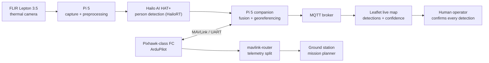

# Thermal Search-and-Rescue Drone

Written by [Taki Sadik](https://tyfsadik.org/about.html) · Last updated 2026-10-22 · Status: Building, first results published · 26 min read

X500-class quadcopter with a FLIR Lepton thermal camera and a Hailo AI HAT+ running person detection at the edge, pushing georeferenced detections to a live map, the Army MINERVA Arctic ISR requirement at hobby scale.

## Overview

The Army's MINERVA challenges say it plainly: Canada currently lacks a drone that can do ISR in Arctic conditions. The Arctic requirement calls specifically for **sovereignty operations and search and rescue with the Canadian Rangers**. Detecting a person in snow or brush from a cheap thermal camera is the sharpest hobby-scale version of that requirement, and it is what this build does.

The airframe is an **X500-class quadcopter** with a Pixhawk-class flight controller. A Raspberry Pi 5 companion computer carries the payload brain: a **FLIR Lepton 3.5 thermal camera** for sensing and a **Hailo AI HAT+** running person detection at the edge, so the drone finds people on board rather than streaming raw video back to a ground station. Every detection is fused with the drone's telemetry into a lat/lon point and published to a **live situational-awareness map**.

The design rule throughout: the drone **cues, a human confirms**. Nothing beyond detection and notification is automated. In a real SAR sweep with the Rangers, the drone is the wide-area sensor and the person on the ground makes every call.

## Bill of Materials

Everything below is purchased and on my bench.

| Item | What I used | Est. US\$ |
|----|----|----|
| Airframe | Holybro X500-class kit with Pixhawk-class controller and GPS | 500-800 |
| Radio | ELRS transmitter (RadioMaster class) + receiver | 80-150 |
| Batteries/charger | 4 LiPo packs, balance charger, LiPo bag | 200-300 |
| Companion computer | Pi 5 4 GB | ~85 |
| Thermal camera | FLIR Lepton 3.5 module or USB thermal camera (256x192 class) | 200-300 |
| AI accelerator | Hailo AI HAT+ for the Pi 5 | 70-110 |
| Spares | Props, prop guards, connectors, landing pad | 60-100 |

## Sensor & Accelerator Specs

These are the numbers the whole payload design hinges on, taken from the FLIR Lepton engineering datasheet and the Hailo AI HAT+ product specification, not from bench anecdotes. The 8.7 Hz frame rate in particular is a hard ceiling that shapes everything downstream: at survey speed the drone moves measurably between frames, which is why step 08 timestamps frames at capture rather than on arrival.

FLIR Lepton 3.5  
160 x 120, VOx microbolometer

Spectral band  
8-14 um LWIR

Frame rate  
8.7 Hz (exportable)

Sensitivity  
\<50 mK (0.05 C)

Field of view  
57 deg horizontal, f/1.1

Radiometric accuracy  
+/-5 C or 5% (high gain)

Flat-field correction  
integrated shutter

Hailo-8L  
13 TOPS INT8, PCIe Gen 3 x1 (single lane on the Pi; the AI HAT+ also ships in a 26 TOPS Hailo-8 variant, this build uses the 13 TOPS Hailo-8L)

**What 160x120 really means:** at 120 m altitude with a 57 degree horizontal field of view, the frame is roughly 130 m wide, so each pixel covers about 0.8 m of ground. A person is a few warm pixels, not a portrait. The detector therefore learns blob shape and thermal contrast, not body detail, and the georeferencing below only ever has to be good enough to walk a ground team to the blob. The ~0.8 m per pixel figure is ground coverage, not a claim of reliable human detection at 120 m: thermal crossover (warm ground, sun-heated rocks), clothing that masks skin temperature, vegetation and weather attenuation, and occlusion all limit what a 160x120 sensor can separate.

## From Thermal Pixel to Map Marker

Step 08 does the math; here is the geometry it encodes. With the camera held near-nadir and the altitude known from the flight controller, each detection's bounding-box centre projects along a ray to the ground. The model is deliberately simple, a pinhole camera with a small-angle correction for the gimbal pitch, because cueing a ground team does not need survey-grade photogrammetry.

### Where the error really comes from

The biggest contributor is not the camera, it is time. At a 10 m/s survey speed, a one-second lag between frame capture and the telemetry used to project it shifts the marker by 10 m. The second is attitude: a few degrees of gimbal pitch error at 120 m altitude moves the ground point by several metres. The pixel math itself is deterministic, but the projection model is approximate; the timestamps and the attitude dominate the error budget, and the model adds its own. That is why the pipeline timestamps frames at capture, matches telemetry by time rather than arrival order, and why T3 measures against a surveyed marker instead of trusting the model on paper.

## Architecture

Figure 1: thermal frames are acquired and preprocessed on the Pi 5, inference runs on the Hailo HAT+, detections fuse with flight telemetry on the Pi, and land on a live map where a human confirms each detection.

## Wiring & Connections

The whole payload chain fits on the X500's top and bottom plates. The two rules that saved me the most pain: **common ground everywhere** (the FC, the Pi, and the receiver must share a ground or serial links misbehave in ways that look like software bugs), and **the Pi gets its own regulator**, never power it from the flight controller's USB port.

| From | To | Cable / interface | Notes |
|----|----|----|----|
| Pixhawk TELEM2 | Pi 5 GPIO UART (GPIO14/15) | JST-GH 6-pin to Dupont | Cross TX to RX; common GND; 921600 baud, MAVLink 2 |
| ELRS receiver | Pixhawk RC input UART | JST servo-style | CRSF protocol; receiver antennas at 90 degrees to each other |
| GPS/compass module | Pixhawk GPS1 + I2C1 | JST-GH 6-pin and 4-pin | Mast-mounted, away from the power distribution board |
| 4S LiPo | Power distribution board | XT60 | First power-up through a smoke stopper, always |
| 5 V / 5 A BEC | Pi 5 USB-C power input | Buck converter, USB-C pigtail | Separate regulator; the Pi 5 browns out under 5 V with the HAT+ loaded |
| PureThermal 3 board (Lepton 3.5) | Pi 5 USB-A | USB 2.0 | Streams raw 16-bit (Y16) frames over UVC |
| Hailo AI HAT+ | Pi 5 40-pin header + PCIe FFC | M.2 HAT ribbon | Hailo-8L over PCIe; gen 3 negotiated in config.txt |
| Camera gimbal (pitch) | Pixhawk AUX out | PWM servo lead | Driven by ArduPilot mount parameters; nadir for search profile |

## How I Built It

### Step 01: Simulation first

Before any flight hardware was powered, I stood up ArduPilot SITL and Gazebo (both free) on the homelab cluster and developed the mission logic there: lawn-mower search patterns, geofences, and failsafes for link loss, low battery, and geofence breach. This builds directly on the simulation environment from my [LENTUS-style drone mapping](https://github.com/TYFSADIK/lentus-drone-mapping) work. The payoff is that every behaviour that could cost me an airframe got exercised in Gazebo first, with Mission Planner connected as the ground station, exactly as it will be flown for real.

**Sitl + gazebo bring-up, and the geofence as flown in simulation**

    # one-time toolchain + build
    git clone --recurse-submodules https://github.com/ArduPilot/ardupilot.git
    cd ardupilot
    ./waf configure --board sitl
    ./waf copter

    # launch a simulated quad in a Gazebo world
    sim_vehicle.py -v ArduCopter -f gazebo-iris --console --map

    # in the MAVProxy console: the Arctic-search geofence profile
    param set FENCE_ENABLE 1
    param set FENCE_TYPE 7        # altitude + circle + polygon
    param set FENCE_RADIUS 300    # metres, stays well inside the test area
    param set FENCE_ALT_MAX 122   # metres AGL, the Canadian basic ceiling (400 ft)
    param set FS_GCS_ENABLE 1     # GCS-loss failsafe

What can go wrong: a `--recurse-submodules`-less clone builds nothing useful (missing `MAVLink` and `gazebo` submodules), and the failsafes only count if you actually test them, I kill the simulated GCS link and watch the quad RTL before calling the profile done.

### Step 02: Airframe build

I assembled the X500-class kit: frame, motors, ESCs, Pixhawk-class flight controller, and GPS. ArduPilot on the flight controller handles all stabilization and navigation; the companion computer never touches the control loop directly, it only asks for missions and reads telemetry. Props went on last, after bench checks of motor order and direction, and prop guards stay on for any early flight.

**Motor order and direction test, props off (mavproxy console)**

    # spin each motor at 10% for 2 seconds, in order A-D,
    # and check it matches the quad-X diagram (A=rear-right CCW, etc.)
    motortest 1 0 10 2
    motortest 2 0 10 2
    motortest 3 0 10 2
    motortest 4 0 10 2

How I verified: a fingertip on each motor bell during its spin confirms direction; if a motor runs backwards I swap any two of its three ESC leads rather than trusting a software reversal. Getting this wrong is the classic first-flight flip, and it is free to check on the bench.

### Step 03: Radio link and failsafes

Control runs over ELRS: a RadioMaster-class transmitter and a receiver wired to a flight-controller UART running the CRSF protocol. ELRS gives me a long-range, low-latency link with real telemetry back to the handset, which matters when the whole concept is a wide-area search. Binding is done with a shared phrase, so the receiver and transmitter pair on power-up with no button dance.

**Crsf input and throttle failsafe parameters**

    SERIAL5_PROTOCOL 23    # RC input (CRSF) on the receiver UART
    RSSI_TYPE 3            # RSSI comes from the receiver protocol
    FS_THR_ENABLE 1        # throttle/radio failsafe action: RTL
    FS_THR_VALUE 975       # PWM below which radio-loss is declared

How I verified: with props off and the drone on the bench, I power the transmitter down and watch the flight mode flip to RTL in Mission Planner. A failsafe you have never deliberately triggered is a failsafe you do not have.

### Step 04: Power system and battery discipline

Four 4S LiPo packs feed the power distribution board over XT60, and a balance charger keeps the fleet healthy. The first power-up of any new wiring goes through a smoke stopper, a current-limiting bulb in series with the battery that turns a dead short into a lit bulb instead of a burnt ESC. Battery failsafe thresholds are set so the drone comes home with margin, not on vapour.

**Battery failsafe profile for 4s packs**

    BATT_LOW_VOLT 14.8    # low warning, start heading home
    BATT_CRT_VOLT 14.0    # critical: land now
    BATT_FS_LOW_ACT 2     # low action: RTL
    BATT_FS_CRT_ACT 1     # critical action: land
    BATT_CAPACITY 5200    # mAh, used for consumed-mAh tracking

What can go wrong: LiPos die quietly from bad storage habits, so every pack lives at storage voltage (about 3.85 V per cell) on the charger, in a fire bag, and a cold pack from an outdoor session warms to room temperature before it ever sees the charger, same discipline as my [cold-soak rig](https://github.com/TYFSADIK/cold-soak-battery-rig).

### Step 05: Companion computer link

The Pi 5 4 GB talks MAVLink to the flight controller over UART. On the Pi, **mavlink-router** splits the telemetry stream so the ground station gets its copy while the onboard detection pipeline consumes its own, one serial link, multiple consumers, no conflicts. This is the same companion-computer pattern ArduPilot documents for Pi-class computers: serial telemetry at 921600 baud, with the Pi receiving attitude, position, and GPS state at a steady rate for the fusion step below.

**/etc/mavlink-router/main.conf on the pi**

    [General]
    TcpServerPort=5760
    ReportStats=false

    [UartEndpoint fc]
    Device=/dev/serial0
    Baud=921600

    [UdpEndpoint gcs]
    Mode=normal
    Address=192.168.1.50
    Port=14550

**Matching flight-controller side (telem2)**

    SERIAL2_PROTOCOL 2    # MAVLink 2
    SERIAL2_BAUD 921      # 921600
    SR2_POSITION 10       # stream rates (Hz) the fusion step relies on
    SR2_EXTRA1 10         # attitude

What can go wrong: the Pi's serial console claims `/dev/serial0` by default, it must be disabled in `raspi-config` with the hardware UART left enabled (`enable_uart=1` in `/boot/firmware/config.txt`). Until I did that, MAVLink heartbeats arrived garbled and I spent an evening blaming the cable.

### Step 06: Thermal capture pipeline

The FLIR Lepton 3.5 rides a PureThermal 3 board, which presents the sensor as a standard UVC camera streaming raw 16-bit (Y16) frames. Y16 is only the transport container, not a calibration guarantee: the values are radiometric only when the sensor runs in radiometric (TLinear) mode with the calibration metadata applied (gain mode, FFC state, housing temperature). Without that, the numbers are scene-relative, not calibrated temperature. A 256x192-class USB thermal camera is the fallback path. Getting clean raw frames into Python is the foundation everything else stands on, so I proved this step on the bench before any AI entered the picture.

**Raw 16-bit capture from the lepton with opencv**

    import cv2

    cap = cv2.VideoCapture(0, cv2.CAP_V4L2)
    cap.set(cv2.CAP_PROP_FOURCC,
            cv2.VideoWriter.fourcc('Y', '1', '6', ' '))
    cap.set(cv2.CAP_PROP_CONVERT_RGB, 0)   # keep raw radiometry

    ok, frame = cap.read()                 # frame is uint16, 160x120
    assert ok and frame.dtype == 'uint16'

How I verified: I point the camera at a mug of hot water and at a cold pack and check that the raw pixel means differ by the expected direction and rough magnitude. If the frame looks like 8-bit grey noise, the FOURCC or `CONVERT_RGB` flag is wrong and the radiometry is being thrown away upstream.

### Step 07: Edge person detection on the Hailo AI HAT+

The **Hailo AI HAT+** (Hailo-8L) runs person detection at the edge via **HailoRT**, so inference happens on the drone with no video downlink required. The starting point is a YOLOv8s person model, fine-tuned on thermal imagery of people in snow and brush (the free FLIR ADAS thermal dataset plus my own captures), then compiled to a HEF for the 8L with the Hailo Dataflow Compiler. A warm human shape against a cold, low-clutter background is actually an easier detection problem than visible-light SAR, which is exactly why the MINERVA requirement points this way.

**Hailo stack bring-up and model compile**

    sudo apt install hailo-all          # HailoRT, PCIe driver, Tappas
    hailortcli fw-control identify      # verify the HAT+ enumerates

    # fine-tune on thermal person imagery, export, compile for the 8L
    yolo train model=yolov8s.pt data=thermal-person.yaml imgsz=640 epochs=100
    yolo export model=runs/detect/train/weights/best.pt format=onnx
    hailomz compile yolov8s --ckpt best.onnx --hw-arch hailo8l \
        --calib-path calib-thermal/

What can go wrong: the Pi 5's PCIe link defaults off, so `dtparam=pciex1` (and `dtparam=pciex1_gen=3` for full speed) must be set in `config.txt` before the HAT+ enumerates at all. Also, calibrating quantization on daylight visible images instead of thermal frames wrecks accuracy: the calibration set has to look like the deployment data.

### Step 08: Georeferencing

Each detection is fused with the drone's telemetry at that instant, position, altitude, and gimbal/camera attitude, to project the bounding-box centre into a lat/lon point on the ground. With the camera pointing near-nadir and altitude from the flight controller, a pinhole-camera projection is good enough for cueing a ground team.

**Telemetry sync and ground projection (pymavlink)**

    from pymavlink import mavutil
    import math

    conn = mavutil.mavlink_connection('/dev/serial0', baud=921600)
    pos = conn.recv_match(type='GLOBAL_POSITION_INT', blocking=True)
    att = conn.recv_match(type='ATTITUDE', blocking=True)

    def project(cx, cy, w, h, alt_m, hfov_deg, vfov_deg, pitch_rad, yaw_rad):
        # Near-nadir pinhole projection with separate horizontal/vertical FOV
        # and vehicle yaw. Flat-terrain, fixed-camera, small-angle MODEL ONLY:
        # terrain elevation, altitude above ground (not sea level), boresight
        # calibration, lens distortion, and frame/telemetry timestamp alignment
        # all add error on top of this approximation.
        half_h = math.radians(hfov_deg) / 2
        half_v = math.radians(vfov_deg) / 2
        x_m = alt_m * math.tan(half_h * (cx / w - 0.5) * 2)          # right of boresight
        y_m = alt_m * math.tan(pitch_rad + half_v * (0.5 - cy / h) * 2)  # ahead of boresight
        north_m = y_m * math.cos(yaw_rad) - x_m * math.sin(yaw_rad)  # camera frame -> north/east
        east_m  = y_m * math.sin(yaw_rad) + x_m * math.cos(yaw_rad)
        return north_m, east_m   # converted to lat/lon via local tangent plane

What can go wrong: fusing a detection with telemetry that is even a second stale puts the marker tens of metres off at survey speed, so the pipeline timestamps frames at capture and matches them against the telemetry buffer by time, not by arrival order.

### Step 09: Live map over MQTT

Georeferenced detections are published over **MQTT** to a **Leaflet** situational-awareness map. Each marker carries its confidence score and a cropped thermal thumbnail, and the planned flight path renders alongside so the operator can see what has been covered. A human confirms every detection; the system does nothing beyond cueing. In a real search, that map is what the Ranger team lead watches.

**Broker, test publish, and the map client**

    sudo apt install mosquitto mosquitto-clients
    mosquitto_pub -h localhost -q 1 -t sar/detections \
        -m '{"lat":43.7735,"lon":-79.4158,"conf":0.83,"ts":1791536000}'

    const map = L.map('map').setView([43.7735, -79.4158], 15);
    L.tileLayer('https://tile.openstreetmap.org/{z}/{x}/{y}.png').addTo(map);
    const client = mqtt.connect('ws://192.168.1.50:9001');
    client.subscribe('sar/detections');
    client.on('message', (topic, payload) => {
      const d = JSON.parse(payload.toString());
      L.circleMarker([d.lat, d.lon],
        {radius: 8, color: d.conf > 0.7 ? 'red' : 'orange'}).addTo(map)
        .bindPopup('confidence ' + d.conf + ' - human confirm required');
    });

What can go wrong: field Wi-Fi drops constantly, so the Pi buffers unsent detections to disk and republishes on reconnect with QoS 1; a detection that silently vanishes is worse than a delayed one. The map renders the marker exactly as published, the human decides what it means.

### Step 10: Compliance gate before flight

The airframe is well over 250 g, so outdoor flight waits on **Transport Canada registration and a pilot certificate**, plus a **NAV CANADA airspace check** of the intended test area. Until that gate clears, everything flies in SITL and the payload pipeline gets exercised on bench and ground runs.

**Pre-flight compliance checklist, the gate**

    [ ] Drone registered - Transport Canada Drone Management Portal
    [ ] Pilot Certificate (Basic minimum; Advanced for the sites I want)
    [ ] NAV CANADA Drone Site Selection Tool: airspace class checked
    [ ] RPAS flight authorization if the site is controlled airspace
    [ ] Visual observers, site survey, and bystander distance planned
    [ ] Failsafes re-verified on the day, props off first

What can go wrong: treating registration as paperwork to do later. In Canada it is the flight itself that is illegal without it, so the checklist blocks outdoor power-up, not just the paperwork folder.

## Testing & Metrics

The test protocol mirrors how a real SAR sensor would be evaluated, scaled down to what a bench and a backyard allow. Each run has a defined setup, procedure, and metric; nothing counts as measured until it is logged from an actual run. Flight-derived numbers are pending, the airframe is still inside the compliance gate, so results to date come from SITL and bench/ground payload runs.

### Test Runs

1.  **T1, Bench thermal capture.** Setup: Lepton on the Pi, known hot and cold references (mug of water at measured temperature, ice pack). Procedure: capture raw 16-bit frames at each reference, record pixel means. Metric: capture rate in frames per second and monotonic response of pixel mean to reference temperature.
2.  **T2, Detection performance, ground runs.** Setup: a person standing, kneeling, and lying in snow and in brush, with the payload walked or tripod-mounted at increasing slant ranges. Procedure: run the Hailo pipeline on recorded and live frames, log every detection with confidence. Metric: recall per range band and false alarms per hour of empty-background footage. Target: high recall at short ranges with a false-alarm rate low enough that the human confirmer is not flooded.
3.  **T3, Georeferencing error.** Setup: a ground marker surveyed with the u-blox GNSS from my rover kit as a reference track (meter-class GNSS, not survey grade). Procedure: ground runs at several altitudes and off-nadir angles (payload elevated, not yet flown), compare reported lat/lon against the marker reference. Metric: horizontal error in metres, binned by altitude and angle. Target: error small enough to walk a ground team to the marker.
4.  **T4, End-to-end latency.** Setup: full live pipeline, camera, Hailo, fusion, MQTT broker, map, on the bench network. Procedure: introduce a warm target on a known timestamp and time its appearance as a map marker. Metric: frame-to-marker latency in seconds. Target: seconds, not minutes.
5.  **T5, Failsafe behaviour.** Setup: SITL first, then the real airframe with props off, then controlled flight after the compliance gate. Procedure: trigger link loss, low battery, and geofence breach in turn. Metric: correct mode transition (RTL or land) in every case, with the transition logged.
6.  **T6, Mission endurance.** Setup: fully loaded aircraft (payload, Pi, Hailo running) after the compliance gate. Procedure: fly the search pattern on one pack until the low-battery failsafe. Metric: usable minutes per pack; the cold-weather derating for these packs comes from my [cold-soak characterization rig](https://github.com/TYFSADIK/cold-soak-battery-rig) dataset rather than being invented here.

### Targets and Current Status

| Metric | Target | Current status |
|----|----|----|
| Thermal capture rate (T1) | Sustained sensor-native frame rate with no dropped frames in 10-minute runs | In progress, capture path proven on the bench, long runs ongoing |
| Detection recall, short range (T2) | High recall on standing/kneeling/lying targets in snow and brush | In progress, model fine-tuning and ground-run data collection underway |
| False-alarm rate (T2) | Low enough that every alarm gets a human look without fatigue | In progress, empty-background soak tests running |
| Georeferencing error (T3) | Marker accuracy a ground team can walk to | In progress, ground-run setup built, measurements not yet published |
| Frame-to-marker latency (T4) | Seconds on the live pipeline | In progress, pipeline integrated, timing harness next |
| Failsafe correctness (T5) | Correct RTL/land in 100% of triggered scenarios | SITL scenarios exercised; real-airframe triggers pending |
| Endurance per pack (T6) | Search-pattern flight time with reserve margin, warm and cold | Not yet flown, blocked on the compliance gate; cold derating comes from the cold-soak dataset |

Measured figures will be published here once outdoor testing is lawful and complete. Until then, every number above is a target, not a result.

## Troubleshooting & Lessons

- **Garbled or zero MAVLink on the Pi.** Symptom: mavlink-router connects but heartbeats never parse. Causes found: the Pi's serial console still owned `/dev/serial0`, and TX/RX were not crossed on the JST-GH-to-Dupont adapter. Fix: disable the serial console in `raspi-config`, keep `enable_uart=1`, cross the lines, and share ground between FC and Pi. Lesson: with serial, verify the physical layer with a loopback test before touching software.
- **Hailo AI HAT+ invisible to the OS.** Symptom: `hailortcli fw-control identify` finds nothing. Cause: the Pi 5 ships with the external PCIe lane off, and a loosely seated FFC ribbon looks identical to a dead board. Fix: `dtparam=pciex1` and `dtparam=pciex1_gen=3` in `config.txt`, reseat the ribbon, then re-check enumeration.
- **Thermal frames freeze for a beat, mid-run.** Symptom: the Lepton stream stalls for a fraction of a second at intervals. Cause: the sensor's flat-field correction (FFC) shutter events, normal Lepton behaviour, not a bug. Fix: schedule FFC during non-critical moments (on the ground, or between search legs) and have the pipeline tag frames around FFC as degraded rather than feeding them to the detector.
- **Radio failsafe triggers during a range walk.** Symptom: RTL declared at a shorter distance than expected with the transmitter live. Cause: receiver antennas parallel to each other and shadowed by the frame. Fix: mount the two ELRS antennas at 90 degrees, clear of carbon and the battery, then re-run the range check with props off. Lesson: a failsafe that fires early in testing is doing its job, fix the RF, not the threshold.
- **Detections vanish when the field Wi-Fi drops.** Symptom: markers stop appearing on the map and never catch up after reconnect. Cause: fire-and-forget MQTT publishes with no local buffer. Fix: QoS 1 plus an on-disk spool on the Pi that republishes in order on reconnect, the store-and-forward discipline from my DDIL work, applied at drone scale.

## Legal & Safety Notes (Canada)

**Drone rules:** anything over 250 g must be registered and flown under a Transport Canada pilot certificate. The X500-class kit is well over that, so flights wait until the certificate, registration, and a NAV CANADA airspace check are done, NAV CANADA's airspace tools come before every flight, not after. Simulation (ArduPilot SITL + Gazebo) carries the early software work.

**LiPo safety:** packs live in a fire bag, charge only on a balance charger, and are never charged cold or frozen, a pack coming in from the cold warms to room temperature before the charger connects. Same discipline as the cold-soak rig.

## Status & Roadmap

- **Done**: all components purchased and on the bench; ArduPilot SITL + Gazebo environment running on the homelab cluster with search patterns, geofences, and failsafes exercised; airframe assembled with motor order/direction and radio failsafe bench-verified; Pi 5 talking MAVLink over UART through mavlink-router; raw 16-bit Lepton capture bench-verified in Python (transport verified; radiometric calibration still open).
- **In progress**: thermal person model fine-tuning and Hailo compilation; ground-run detection and georeferencing test runs (T2/T3); Leaflet map consuming MQTT detections; end-to-end latency harness.
- **Next**: Transport Canada registration and pilot certificate; NAV CANADA airspace check for the test area; first outdoor flight; measured detection and georeferencing results published here; feed detections into the multi-domain common operating picture.

## Related Builds

- [**Canadian Defence Hardware Program**](https://github.com/TYFSADIK/defence-hardware-program), the hub page: how this build fits the Defence Drone Initiative, MINERVA challenges, and the rest of the bench.
- [LENTUS-Style Drone Mapping](https://github.com/TYFSADIK/lentus-drone-mapping), the ArduPilot SITL + Gazebo simulation basis this drone's mission logic is built on.
- [Cold-Soak Characterization Rig](https://github.com/TYFSADIK/cold-soak-battery-rig), the battery dataset that derates this drone's packs for Arctic operations.
- [Passive Acoustic Drone Detector](https://github.com/TYFSADIK/acoustic-drone-detector), the receive-only sibling: detecting other drones instead of people.
- [Multi-Domain Common Operating Picture](https://github.com/TYFSADIK/multi-domain-common-operating-picture), where this drone's signed detections end up once the fusion layer is live.

## Build Narrative: Phase by Phase

**Phase 1: airframe.** An X500-class quadcopter with a Pixhawk-class flight controller. Motor order and direction and the radio failsafe were bench-verified before anything flew. A range walk later showed the ELRS failsafe declaring RTL earlier than expected, traced to receiver antennas mounted parallel and shadowed by the frame, fixed by mounting them at 90 degrees clear of carbon and the battery.

**Phase 2: simulation first.** ArduPilot SITL with Gazebo runs on the homelab cluster: search patterns, geofences, and failsafes are all exercised in simulation before outdoor flight. Nothing about the mission logic meets the real sky untested.

**Phase 3: companion computer link.** The Pi 5 talks MAVLink to the flight controller over UART through mavlink-router. Bringup fought the Pi's serial console owning /dev/serial0 and uncrossed TX/RX on the JST-GH-to-Dupont adapter; the fix sequence was disable the console in raspi-config, keep enable_uart=1, cross the lines, share ground. Serial gets a loopback test before software now.

**Phase 4: thermal capture.** The FLIR Lepton 3.5 (160x120 microbolometer, 8.7 Hz, 14-bit sensor output carried as raw 16-bit frames) streams frames captured in Python. The values are radiometric only with the sensor's radiometric mode and calibration metadata applied; the raw-capture path is bench-verified, calibration is still open. Its flat-field-correction shutter events stall the stream for a fraction of a second at intervals, which is normal Lepton behaviour: FFC is scheduled for non-critical moments and frames around FFC are tagged degraded rather than fed to the detector.

**Phase 5: edge AI.** The Hailo AI HAT+ runs person detection on board so the drone finds people without streaming raw video to a ground station. Bringup needed dtparam=pciex1 and pciex1_gen=3 in config.txt (the Pi 5 ships with the external PCIe lane off) plus a reseated FFC ribbon, confirmed with hailortcli fw-control identify.

**Phase 6: georeferencing and map.** Every detection fuses with the drone's telemetry into a lat/lon point and publishes to a Leaflet situational-awareness map over MQTT. An early fire-and-forget design lost detections whenever field Wi-Fi dropped; the fix was QoS 1 plus an on-disk spool that republishes in order on reconnect, the store-and-forward discipline from the DDIL work applied at drone scale.

## What You Need

The build assumes you already fly or are learning to fly responsibly. The regulatory items are not optional extras: they gate the outdoor flight tests.

| Category | Item | Notes |
|----|----|----|
| Hardware | X500-class airframe + Pixhawk-class FC | Quadcopter kit with GPS; bench-verify motor order/direction and radio failsafe before flight |
| Hardware | ELRS radio system | RadioMaster-class transmitter and receiver; mount receiver antennas at 90 degrees, clear of carbon |
| Hardware | LiPo packs, balance charger, LiPo bag | Four packs for rotation through test days; charge and store safely |
| Hardware | Pi 5 4 GB + Hailo AI HAT+ | Companion computer and the edge accelerator; enable the Pi 5 PCIe lane in config.txt |
| Hardware | FLIR Lepton 3.5 thermal module | 160x120 LWIR microbolometer, 8.7 Hz, 14-bit sensor output in raw 16-bit frames (radiometric calibration still open); schedule FFC shutter events around detection windows |
| Software | ArduPilot, SITL + Gazebo | Flight stack and the simulation environment where missions are proven first |
| Software | mavlink-router, HailoRT, Python | Companion link, accelerator runtime, capture and georeferencing pipeline |
| Skills | Drone assembly, serial debugging, basic ML workflow | Soldering, UART bringup, model fine-tuning and compilation for an edge accelerator |
| Accounts | Transport Canada registration + pilot certificate | Required before outdoor flight, plus a NAV CANADA airspace check for the test area |

## Challenges and Lessons Learned

- **Garbled or zero MAVLink on the Pi.** The serial console owned /dev/serial0 and TX/RX were uncrossed on the adapter. Lesson: with serial, verify the physical layer with a loopback test before touching software.
- **The Hailo AI HAT+ was invisible to the OS.** The Pi 5 ships with the external PCIe lane off, and a loosely seated ribbon looks identical to a dead board. Lesson: dtparam=pciex1 and gen=3 first, reseat the ribbon second, then check enumeration.
- **Thermal frames froze for a beat, mid-run.** Lepton flat-field-correction shutter events, normal sensor behaviour, not a bug. Lesson: schedule FFC for non-critical moments and tag frames around it as degraded.
- **Radio failsafe triggered during a range walk.** Receiver antennas were parallel and shadowed by the frame. Lesson: a failsafe that fires early in testing is doing its job, fix the RF (90-degree antenna placement), not the threshold.
- **Detections vanished when field Wi-Fi dropped.** Fire-and-forget MQTT with no local buffer. Lesson: QoS 1 plus an on-disk spool that republishes in order on reconnect.

## What Is Next

- Transport Canada registration and the pilot certificate, then the NAV CANADA airspace check for the test area.
- First outdoor flight with the full payload chain live: thermal capture, Hailo person detection, georeferencing, map.
- Publish measured detection and georeferencing results: ranges, altitudes, false alarms, and how far the lat/lon points land from the truth.
- Feed detections into the multi-domain common operating picture as the air-domain node.
- Cold-weather flight validation, informed by the battery cold-soak dataset from the rig in this same program.

## Cite This Page

**Plain text**

    Taki Sadik, "Thermal Search-and-Rescue Drone", TYFSADIK, https://github.com/TYFSADIK/thermal-sar-drone (accessed 2026-10-22).

**BibTeX**

    @misc{sadik-thermal-sar-drone,
      author  = {Sadik, MD. Taki Yasir Faraji},
      title   = {Thermal Search-and-Rescue Drone},
      year    = {2026},
      url     = {https://github.com/TYFSADIK/thermal-sar-drone},
      urldate = {2026-10-22}
    }

**APA**

    Sadik, M. T. Y. F. (2026). Thermal Search-and-Rescue Drone. TYFSADIK. https://github.com/TYFSADIK/thermal-sar-drone

---

Original page: <https://github.com/TYFSADIK/thermal-sar-drone>
